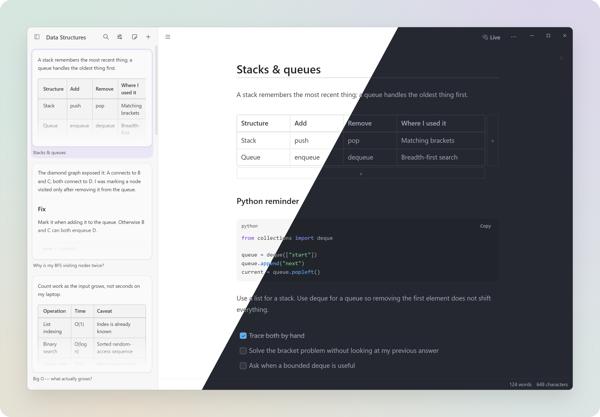

# Kuskus

Kuskus keeps your project references in one place: Markdown notes, images, files, and bookmarks. Your library lives in a folder on your computer, with ordinary files you can open outside the app.

Kuskus is still taking shape, and contributions are welcome.

[](https://kuskus-tau.vercel.app)

## Try it

You can explore the [browser demo](https://kuskus-tau.vercel.app). It uses sample content; edits are temporary and don’t write to your computer.

The desktop app is an early preview. Windows is the first installer target; macOS and Linux builds are experimental. Signing and native Windows testing are still outstanding. Check the [release checklist](docs/14-open-source-release-checklist.md) before distributing builds. Updates are manual.

If you run the app from source, start with a test library. Close Kuskus and back up your whole vault, including its hidden `.kuskus` folder, before trying a new version. Interrupted moves and renames use a persisted recovery journal. Power-loss durability and native release verification remain separate gates; see the [beta plan](docs/18-beta-release-plan.md).

## What you can do

- Write Markdown notes, with attachments and links between notes
- Collect images, files, and web references in nested folders
- Search your library, pin items, and return to recently opened work
- Open notes in separate windows or use quick capture
- Read PDFs offline, including text selection and search
- Move items to Trash and restore them later

Existing Markdown folders work without converting their notes. Kuskus stores its index and app metadata in `.kuskus`. Scanned PDFs need a text layer for search; OCR and PDF editing aren’t included.

## Your files and network requests

Library content stays on your computer. Fetching a bookmark’s title or preview contacts that website. Remote images in Markdown contact their hosts, too. Those requests share normal connection details, including your IP address and the requested URL. Local notes and files work offline.

## Run from source

Install pnpm 11.26.0 using Node.js 22 or later. The project uses Node.js 24.19.0 for its scripts; pnpm downloads that version during installation. It’s also pinned in `.mise.toml`.

```bash
pnpm install --frozen-lockfile
pnpm dev
```

The install step downloads Electron’s native runtime. If that download hasn’t completed, run `pnpm exec install-electron`, then `pnpm exec electron --version` before starting the app.

Use `pnpm dev:demo` for a separate sample library, or `pnpm dev:onboarding` for a fresh start. The [development guide](docs/development.md) covers these profiles, Storybook, and the renderer tools.

## Check your changes

Run the regular checks before opening a pull request:

```bash
pnpm check
pnpm audit --prod
```

`pnpm check` covers formatting, tests, lint, type checks, desktop and website builds, and the renderer bundle budget. The audit checks known dependency advisories separately.

`pnpm check:release` also audits production and development dependencies, builds Storybook, packages the app, and inspects the archive. It doesn’t publish anything. See [release maintenance](docs/20-release-maintenance.md) for a clean build and [versioning](docs/19-versioning.md) for release notes.

## Build the desktop app

Run `pnpm build`, then `pnpm start` to open the compiled app. Build output goes into `out/`.

For local packages, use `pnpm build:win`, `pnpm build:mac`, or `pnpm build:linux`. These commands don’t publish. `pnpm release` verifies the candidate and builds signed Windows installers, which requires signing credentials. Follow the [release process](docs/15-release-process.md) before distributing them.

## Help build Kuskus

Bug reports, small fixes, and accounts of how you use the app are welcome. For feature requests, describe the task you’re trying to finish and what gets in your way.

Read [CONTRIBUTING.md](CONTRIBUTING.md) before sending a change. AI-assisted contributions are welcome. You’re responsible for understanding and checking what you submit, and for disclosing the tool and model in your PR. The [PR guide](docs/pull-requests.md) shows the format.

Report vulnerabilities privately through the route in [SECURITY.md](SECURITY.md).

For more context, read the [product brief](docs/00-product-brief.md), [architecture](docs/10-current-architecture.md), and [implementation rules](AGENTS.md). The [website guide](landing-page/README.md) covers the landing page and interactive demo.

## License

Kuskus is licensed under [GNU GPL version 3 only](LICENSE) (`GPL-3.0-only`). Third-party code and assets keep their own licenses and notices; see the [asset inventory](docs/16-third-party-assets.md).
